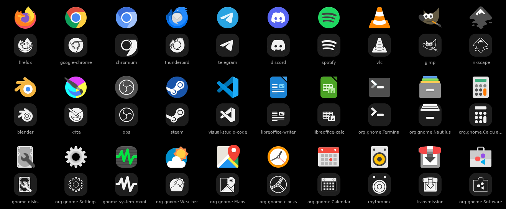

# monotile

**Nothing-inspired monochrome icons for every app on your Linux desktop.**

monotile turns your desktop's icons into flat white monochrome icons in the spirit of
Nothing OS: app and menu icons on a dark circle or squircle, and folders, file types,
devices and status icons as white line art in their own shape. It writes the result as
a normal icon theme, so your desktop shows it like any other theme, and it can keep
that theme up to date as you install and remove apps.


<details><summary>Squircle tiles</summary>


</details>


### What gets converted

| Icons | Style |
|---|---|
| Apps and application-menu categories | white stencil on a dark circle or squircle |
| Folders and places, file types, devices, emblems | white stencil in the icon's own shape (no tile) |
| Status icons that are coloured | white stencil in their own shape |
| Status icons that are already monochrome, panel, tray and toolbar (symbolic) icons | left as they are |

Papirus's extra folder colour variants (`folder-red-…`) are skipped; the default folders are converted.

> Unofficial fan project. Not affiliated with or endorsed by Nothing Technology Limited.
> No Nothing fonts, wallpapers or artwork are included.

## Desktop widgets (Cinnamon desklets)

`desklets/` contains five matching desktop widgets as native Cinnamon desklets, so they
behave like any other desklet: add or remove them with **right-click on the desktop >
Add Desklets**, drag them anywhere, change them with **right-click > Configure**, and they
stay visible when you show the desktop.

| Desklet | Shows | Options |
|---|---|---|
| Mono Clock | 12-dot analog dial with a red second hand, or dot-matrix digital time | style, seconds, 24-hour |
| Mono Date | weekday, dot-matrix day number, month | weekend accent, year |
| Mono Weather | temperature, condition, place ([wttr.in](https://wttr.in), no API key) | location, °C/°F, update interval |
| Mono System | concentric RAM and disk rings, number in the middle | RAM / CPU / disk, mount point, update interval |
| Mono Day | 24 dots for the day, or 12 for the year | day / year |

Every desklet also has a size, card opacity and accent colour setting.

```sh
./desklets/install.sh            # install; then add them from Add Desklets
./desklets/install.sh --enable   # install and place all five on the desktop
./desklets/install.sh --uninstall
```

The number font is Nothing's *Ndot 57* and the labels use *JetBrains Mono*; neither is
bundled. Without them the desklets fall back to your default fonts.

## Why a generator?

On Android, apps ship a separate monochrome layer and the launcher simply tints it.
Linux apps ship one finished, coloured image, so there is nothing to tint. monotile
rebuilds a monochrome version from that image instead:

1. **Flatten** the icon into its main colour regions (gradients and edge pixels merge).
2. **Find the background plate** (a coloured circle, squircle or rectangle behind the
   symbol) and turn it into the dark tile.
3. **Draw every remaining part in white**, with thin dark cuts wherever two different
   parts meet, so details survive as a stencil instead of merging into a blob.
4. **Outline large grey bodies** (a hard drive under a wrench, a metal cabinet) instead of
   filling them, so the symbols on top stay visible.
5. **Compose** onto the tile and render every size from 16 to 256 px.

The result is deterministic: the same icon and settings always give byte-identical output.

## Requirements

- Linux with a freedesktop.org desktop (see [compatibility](#compatibility))
- Python 3.9+, Pillow, PyGObject with GdkPixbuf and the librsvg SVG loader
- Optional: `gtk-update-icon-cache` (recommended), systemd user session (for `watch`)
- A colourful source theme. [Papirus](https://github.com/PapirusDevelopmentTeam/papirus-icon-theme)
  gives the best results and is used automatically when installed.

**Debian / Ubuntu / Linux Mint**

```sh
sudo apt install python3-pil python3-gi gir1.2-gdkpixbuf-2.0 librsvg2-common gtk-update-icon-cache papirus-icon-theme
```

**Fedora** (untested)

```sh
sudo dnf install python3-pillow python3-gobject gdk-pixbuf2 librsvg2 gtk-update-icon-cache papirus-icon-theme
```

**Arch** (untested)

```sh
sudo pacman -S python-pillow python-gobject gdk-pixbuf2 librsvg gtk-update-icon-cache papirus-icon-theme
```

## Quick start

No installation needed; run it straight from a clone:

```sh
git clone https://github.com/<you>/monotile.git
cd monotile
./run-monotile preview -o preview.png   # before/after sheet of your apps; changes nothing
./run-monotile apply                    # generate the theme and switch to it
./run-monotile watch enable             # keep it updated when apps are installed or removed
```

To undo: `./run-monotile revert` (back to your previous icon theme) or
`./run-monotile uninstall --yes` (revert, stop watching and delete the generated theme).

You can also install it with `pipx install .` and run `monotile` instead of `./run-monotile`.

## Commands

| Command | What it does |
|---|---|
| `preview` | Renders a before/after contact sheet of your apps. Writes only the image. |
| `generate` | Creates or updates `~/.local/share/icons/Monotile`. Only changed icons are reconverted (in parallel; names that share one image are converted once and symlinked); `--dry-run` reports without writing. |
| `apply` | Generates if needed, then sets the icon theme. Your previous theme is saved once. |
| `revert` | Restores the icon theme you had before `apply`. |
| `status` | Shows what is generated, active and watched. |
| `watch enable\|disable\|status` | Installs a systemd **user** path unit that regenerates within seconds when a `.desktop` file is added, changed or removed. No root, no background daemon. |
| `uninstall --yes` | Reverts, disables the watcher and deletes the generated theme. Settings and overrides are kept. |

Style options work with `preview`, `generate` and `apply`, and are remembered:

| Option | Values | Default |
|---|---|---|
| `--shape` | `circle`, `squircle` | `circle` |
| `--tones` | `2` white stencil · `3` large grey bodies filled grey · `4` white / light grey / mid grey | `2` |
| `--source` | icon theme to read app icons from | Papirus if installed |
| `--fallback` | icon theme for everything that is not an app icon (folders, file types…) | your icon theme at first run |
| `--name` | name of the generated theme | `Monotile` |
| `--contexts` (generate) | which kinds to convert: `apps,categories,places,mimetypes,devices,status,emblems` | all |
| `--context` (preview) | which kind to show in the preview sheet | `apps` |

Settings live in `~/.config/monotile/config.json`.

## Fixing individual icons

Automatic conversion cannot be perfect for every logo. To replace one, drop your own
icon into `~/.config/monotile/overrides/`, named after the app's icon name:

```sh
cp my-whatsapp.svg ~/.config/monotile/overrides/whatsapp.svg
./run-monotile generate        # or just wait: the watcher picks it up
```

Overrides are used as they are (SVG or PNG), not converted. To find an app's icon name,
look for the `Icon=` line in its `.desktop` file.

## Compatibility

| Desktop | Generate | `apply` / `revert` | Tested |
|---|---|---|---|
| Cinnamon 6.4 (X11) | ✅ | ✅ (`org.cinnamon.desktop.interface`) | ✅ Debian 13 |
| GNOME | ✅ | ✅ (`org.gnome.desktop.interface`) | ❌ not yet |
| MATE, Xfce, KDE Plasma, others | ✅ | ❌ select the *Monotile* icon theme in your settings | ❌ not yet |

Apps from distro packages, Flatpak exports and local `~/.local/share/applications` entries are
discovered. Reports from other desktops are very welcome.

## Limitations

- **Runtime window icons.** Some windows (unmatched X11 apps, some Electron apps, browser
  web apps) send their own icon at runtime; taskbars may show that instead of the themed one.
- **Panel caches.** Some panels keep icons they already loaded. `apply` and the watcher trigger a
  reload; if an icon still looks old, log out and back in.
- **Icons given as file paths.** Apps whose `.desktop` file uses an absolute icon path
  (common for Snap and AppImage) cannot be themed by any icon theme. `generate -v` lists them.
- **KDE apps on other desktops** read their icon theme from `~/.config/kdeglobals`, not from
  GTK settings.
- **First full run takes a few minutes** (about 2,000 unique images with Papirus; about 4 minutes
  on a 12-thread laptop) and uses roughly 100 MB. Later runs only touch what changed.
- **Imperfect conversions.** Icons whose symbol has the same colour as their background, or
  that are mostly a plain screen, can lose detail. Use an override.

## How it fits together

```
installed .desktop files ──> lookup.py ──> icon file from the source theme
                                               │
                         overrides/ ───────────┤
                                               ▼
                                          poster.py  (flatten → plate → stencil → tile)
                                               │
                                               ▼
                 theme.py  ~/.local/share/icons/Monotile/{16..256}x{..}/apps/*.png
                           index.theme (Inherits=<fallback>) + icon cache + manifest
                                               │
                 desktop.py  gsettings apply / revert        watch.py  systemd --user path unit
```

- `lookup.py` follows the freedesktop Desktop Entry and Icon Theme specs: XDG data dirs,
  local entries overriding system ones, theme inheritance, scaled and symlinked directories,
  `/usr/share/pixmaps`. Icon names are validated before they are used in any path.
- `theme.py` keeps a manifest (source path, mtime, size and a hash of the settings) so reruns
  only touch what changed, writes files atomically, holds a lock against concurrent runs, and
  never deletes anything it did not create.
- Nothing in monotile runs shell commands built from `.desktop` contents, and app `Exec=`
  lines are never executed.

## Development

```sh
PYTHONPATH=. python3 -m unittest discover -s tests   # isolated temp XDG dirs
python3 docs/make_demo.py                            # rebuild the README images
```

The tests never touch your real icon theme or settings: they run against a fake desktop in a
temporary directory and an in-memory settings backend.

## Credits and licence

- App icons used as input and in the demo images: [Papirus icon theme](https://github.com/PapirusDevelopmentTeam/papirus-icon-theme), GPL-3.0.
- Inspired by the monochrome icon look of Nothing OS.

monotile is free software under the [GNU General Public License v3.0 or later](LICENSE).
